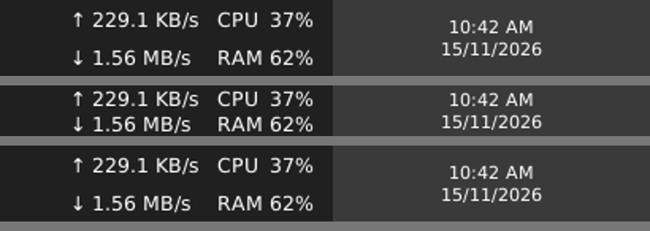

NetMeter: network speed, CPU, memory, GPU, disk and temperatures in your Windows taskbar.

## Download

| File | What it is |
|---|---|
| **NetMeter-Setup-{VERSION}.exe** | Installer: the easy option. No admin rights needed. Adds a Start-menu shortcut and can start NetMeter when you sign in. |
| **NetMeter-portable-{VERSION}.zip** | The same app without installing. Unzip it anywhere and run `NetMeter.exe`. |

Windows 10 or 11, 64-bit. Python is not needed. The files appear here a couple of minutes after the release is published, once the automatic build finishes.

> Windows SmartScreen may say "Windows protected your PC", because the app isn't signed with a paid certificate. Click **More info › Run anyway**.

## What's in it

- **Taskbar display** inside the taskbar, next to the clock or at the left end. Right-click it for every option.
- **Fits the new Windows 11 taskbar** at the top, bottom, left or right, at any size. On narrow side taskbars, labels move above values and speeds shorten.
- **Custom taskbars** like Hitodama: the stats attach to the end of the dock, in a panel of the same colour and height. You can also drag them anywhere on the taskbar.
- **What it shows:** upload, download and total speed, CPU, memory, GPU and disk usage, CPU frequency, today's traffic, and CPU, GPU, disk and mainboard temperatures (via LibreHardwareMonitor).
- **Customise everything:** items, order, labels, per-item colours, font, light/dark/custom themes, see-through or pill background, and bar or line usage graphs. Number formats: bits or bytes, fixed units, short mode.
- **Floating window** with 8 skins plus your own, opacity, lock, click-through, and hide while a full-screen program runs.
- **Traffic history:** by day, week, month, quarter or year, plus a calendar view and CSV export. **Imports your TrafficMonitor history automatically.**
- **Alerts** for daily or monthly traffic limits, and high memory, CPU or temperatures.
- **Connection details**, a tray icon, Python plugins, and portable mode.
- **Starts reliably with Windows:** no admin rights or scheduled task needed. It waits for the taskbar and re-attaches if Explorer restarts.

Tested automatically on every build: the app is started on a real Windows 11 machine, attaches to the taskbar, and must run without errors.
